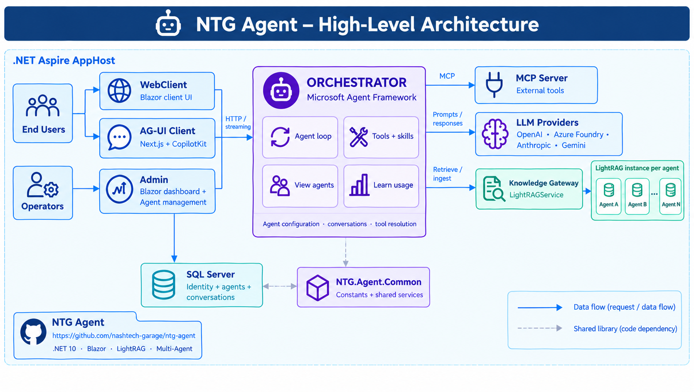

# NTG Agent

NTG Agent is a C# project for exploring and building chatbot applications with modern AI and agent technologies.

[](https://github.com/nashtech-garage/ntg-agent/actions/workflows/ntg-agent-ci.yml)
[](https://sonarcloud.io/summary/new_code?id=nashtech-garage_ntg-agent)
[](https://sonarcloud.io/summary/new_code?id=nashtech-garage_ntg-agent)
[](https://sonarcloud.io/summary/new_code?id=nashtech-garage_ntg-agent)
[](https://sonarcloud.io/summary/new_code?id=nashtech-garage_ntg-agent)


## High-level architecture



## Technologies

- .NET 11
- .NET Aspire
- Blazor
- Microsoft Agent Framework
- LightRAG
- Multiple LLM providers (OpenAI, Azure AI Foundry, Anthropic, and others)
- SQL Server
- Next.js
- Docker and Docker Compose

## Documentation

See the [NTG Agent DeepWiki](https://deepwiki.com/nashtech-garage/ntg-agent) for additional project documentation.

## Getting started

NTG Agent runs locally and uses .NET Aspire to orchestrate its services and dependencies. Docker is required for containerized components, but **Docker Desktop is optional**—any Docker setup accessible to your environment can be used.

### Quick start (Linux/macOS)

On a fresh machine, run the installer:

```bash
curl -fsSL https://raw.githubusercontent.com/nashtech-garage/ntg-agent/main/install.sh | bash
```

The installer checks and installs required tools where supported, configures the local environment, prompts for your LLM provider credentials, and starts NTG Agent.

When setup finishes, stop the application with `Ctrl+C`. For subsequent runs:

```bash
cd ntg-agent
./ntg run
```

If you already cloned the repository, run `./install-local.sh` from its root directory instead.

### Quick start (Windows via WSL2)

1. **Install WSL2 and Ubuntu.** Run this command in PowerShell as Administrator, then follow the prompts:
   ```powershell
   wsl --install
   ```
2. **Set up Docker.** Install and start Docker using Docker Desktop (optional) or another Docker environment that is accessible from WSL2.
3. **Clone and install NTG Agent.** Open your Ubuntu/WSL terminal and run:
   ```bash
   git clone https://github.com/nashtech-garage/ntg-agent.git
   cd ntg-agent
   ./install-local.sh
   ```
   Keep the repository in the WSL2 Linux filesystem (for example, `~/ntg-agent`) rather than under `/mnt/c/` for better build and file-watching performance.

The installer configures the environment and starts the application. Open the Aspire Dashboard URL printed in the terminal; it should be accessible from your Windows browser via `localhost`.

Stop the application with `Ctrl+C`. To start it again from the repository directory:

```bash
./ntg run
```

### What starts locally

.NET Aspire starts the application's services and dependencies, including:

- `sqlserver` — SQL Server 2022 container with persistent storage
- `db-migrate-admin` and `db-migrate-orchestrator` — database migration jobs
- `ntg-agent-mcp-server` and `ntg-agent-orchestrator` — backend services
- `ntg-agent-webclient` — chat UI
- `ntg-agent-admin` — administration UI
- `ntg-agent-ag-ui-webclient` — CopilotKit AG-UI React chat UI

The web clients use the default development admin account:

- **Email:** `admin@ntgagent.com`
- **Password:** `Ntg@123`

Change the default password before using the application in any shared or non-local environment.

The Default Agent is configured on first startup using the selected global LLM settings. To change its provider or model, go to **Agent Management > Agent Default** in the Admin dashboard.

## LightRAG provider configuration

The installer lets you select the global LLM and embedding providers independently. The default provider for both is `openai` if no selection is made.

Supported LLM bindings:

- `openai`
- `ollama`
- `lollms`
- `azure_openai`
- `bedrock`
- `gemini`

Supported embedding bindings:

- `openai`
- `ollama`
- `lollms`
- `azure_openai`
- `bedrock`

Gemini embeddings are not currently supported by the installer's LightRAG embedding configuration.

Configuration is stored in `.env` and copied to AppHost user-secrets.

| Purpose | Variables |
| --- | --- |
| Global LLM | `LIGHTRAG_LLM_BINDING`, `LIGHTRAG_LLM_ENDPOINT`, `LIGHTRAG_LLM_API_KEY`, `LIGHTRAG_LLM_MODEL` |
| Embeddings | `LIGHTRAG_EMBEDDING_BINDING`, `LIGHTRAG_EMBEDDING_ENDPOINT`, `LIGHTRAG_EMBEDDING_API_KEY`, `LIGHTRAG_EMBEDDING_MODEL` |
| LightRAG image | `LIGHTRAG_IMAGE_TAG` |
| Azure OpenAI | `LIGHTRAG_AZURE_API_VERSION`, `LIGHTRAG_AZURE_EMBEDDING_API_VERSION` |
| AWS Bedrock | `LIGHTRAG_AWS_REGION` and either `LIGHTRAG_AWS_BEARER_TOKEN_BEDROCK` or an access-key/secret-key pair |
| Ollama | `LIGHTRAG_OLLAMA_LLM_NUM_CTX` |

Default endpoints include:

| Provider | Endpoint |
| --- | --- |
| OpenAI | `https://api.openai.com/v1` |
| Ollama | `http://localhost:11434` |
| lollms | `http://localhost:9600` |
| Gemini | `DEFAULT_GEMINI_ENDPOINT` |
| Bedrock | `DEFAULT_BEDROCK_ENDPOINT` |

If Ollama or lollms runs in a Docker container, use an endpoint reachable from that container (for example, `http://host.docker.internal:11434` for Ollama).

These settings are applied to each agent's LightRAG container. Changing provider settings, endpoints, models, credentials, or provider-specific options recreates the container. Changing `EMBEDDING_DIM` also resets that agent's vector schema because vectors with different dimensions cannot be mixed.

For the full provider environment reference, see LightRAG's [env.example](https://github.com/HKUDS/LightRAG/blob/main/env.example) and [Docker Compose environment file](https://github.com/HKUDS/LightRAG/blob/main/env.docker-compose-full).

## Dev shortcuts (`ntg`)

`./ntg` is a Bash-based helper for common development commands. No installation is required.

```bash
./ntg                    # Open the interactive command menu
./ntg help               # List commands
./ntg run                 # Run the AppHost and open the Aspire Dashboard
./ntg ports               # Show project port usage
./ntg lightrag-dashboard  # Select an agent and open its LightRAG WebUI
```

### Add a shortcut

Create a new command from the template:

```bash
./ntg new <name>
```

Edit the generated file in `scripts/dev-commands/<name>.sh`: update its `# desc:` line and add your commands. Run it with:

```bash
./ntg <name>
```

It will also appear in the interactive menu and `./ntg help`. Each command is a standalone Bash script in `scripts/dev-commands/`. Scripts whose names start with `_` are treated as hidden helpers.

## Authentication

NTG Agent uses shared cookies. The Admin application uses YARP as a Backend-for-Frontend (BFF) to forward API requests to NTG.Agent.Orchestrator. This approach currently supports Blazor WebAssembly clients; cookies are not sent with server-side Blazor requests.

## Knowledge providers

Document upload, search, and RAG are handled through the `IKnowledgeService` and `IKnowledgeProvisioner` abstractions in `NTG.Agent.Common`. The Orchestrator selects the provider through configuration, allowing the implementation to be changed without modifying the application flow.

Configure the provider in app settings:

```json
{
  "Knowledge": {
    "Provider": "LightRag"
  }
}
```

- **`LightRag` (default):** Creates one LightRAG container per agent. The implementation is in `NTG.Agent.LightRag`. The Orchestrator maintains EF-backed stores for agent port reservations and document ingestion status.

## Contributing

Contributions are welcome:

- Star the project
- Report bugs
- Join discussions
- Suggest features
- Submit pull requests. If you're new to GitHub contributions, see [Contributing to projects through forking](https://docs.github.com/en/get-started/quickstart/contributing-to-projects).

By contributing, you agree that your contributions will be licensed under the Apache-2.0 license.
